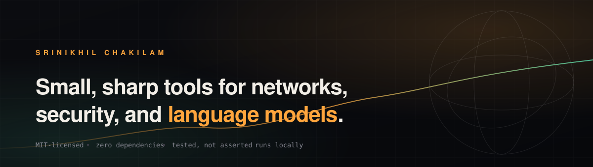

  

I build tools I could not find: short, dependency-free programs that make a hard thing visible — a network, a key leaving a machine, a model learning, a packet's whole life. Everything here is MIT-licensed, runs on your machine, and ships with tests that check the claim instead of asserting it.

### Open two of these right now, no install

| | |
|---|---|
| [**earthwire**](https://rawqubit.github.io/earthwire/) — a 3D globe of the physical internet. | Submarine cables, landing stations, and live BGP route updates from RIPE RIS, drawn in raw WebGL in one self-contained file. No three.js, no bundler. |
| [**lossfall**](https://rawqubit.github.io/lossfall/) — a language model training in your tab. | A 28,032-parameter transformer starts as random noise and learns to write Shakespeare-flavoured English while you watch. Hand-written autograd, live loss curve, readable attention. |

### Tools

| Repo | What it does |
|---|---|
| [**wirecut**](https://github.com/rawqubit/wirecut) | Intercepting HTTPS proxy in one Go binary: its own CA, redacted session logs, header rules, and a UI that replays edited requests. The 80% of Burp you actually use. |
| [**interlock**](https://github.com/rawqubit/interlock) | Egress firewall for AI coding agents. Every outbound request is judged against a deterministic policy before it leaves; every verdict goes into a hash-chained audit log. |
| [**tracelight**](https://github.com/rawqubit/tracelight) | Pure-Go pcap/pcapng reader: Ethernet, IPv4/IPv6, TCP, UDP, DNS, HTTP/1.1 and TLS SNI, assembled into flows with a real filter language. No libpcap, no cgo. |
| [**constellate**](https://github.com/rawqubit/constellate) | Passive OSINT workbench. Certificate transparency, DNS, RDAP and TLS facts become a typed graph you can pivot through — no API keys, no active scanning. |
| [**ctxscope**](https://github.com/rawqubit/ctxscope) | X-ray an LLM context window: where the tokens went, which blocks are duplicated, what you can trim. |
| [**mcp-inspect**](https://github.com/rawqubit/mcp-inspect) | Prices every tool definition an MCP server advertises, with a `--max-tokens` gate you can wire into CI. |
| [**agent-failure-atlas**](https://github.com/rawqubit/agent-failure-atlas) | Forty-one ways production agents fail, each with the symptom, the mechanism, a repro that runs offline in under a second, and the fix. |
| [**llm-cassette**](https://github.com/rawqubit/llm-cassette) | Record one real LLM session and replay it byte-identically, so agent tests are offline, deterministic and free. |
| [**json-salvage**](https://github.com/rawqubit/json-salvage) | Recovers usable data from fenced, truncated, or mid-stream model JSON. |
| [**llmguard-cli**](https://github.com/rawqubit/llmguard-cli) | Real-time prompt-injection and jailbreak detection for LLM pipelines, with an HTTP API. |
| [**shadowmap**](https://github.com/rawqubit/shadowmap) | Passive attack-surface mapping from certificate transparency, DNS and public data only. |

### How I build

- **No dependencies where none are needed.** No npm install, no framework, no CDN. A tool you can read in one sitting is a tool you can trust.
- **Claims get tests.** The autograd in lossfall is checked against finite differences for every parameter tensor; the demo in wirecut runs a real TLS handshake through the proxy in CI. If it says it works, something executed it.
- **Limits stated up front.** Every README has a section that says what the tool does *not* do — no HTTP/2 in wirecut, no live capture in tracelight, synthetic cable geometry in earthwire. You should know the edges before you depend on it.
- **Runs locally, forever.** MIT licensed, no accounts, no telemetry, no server to shut down.

### Elsewhere

[**srinikhilchakilam.com**](https://srinikhilchakilam.com) · [LinkedIn](https://linkedin.com/in/srinikhilchakilam) · [X](https://x.com/rawqubit)

Most of what is here started as a question I could not answer from a screenshot: where did those tokens go, what is actually on the wire, who is that certificate for, what does the model do before it gets good.
